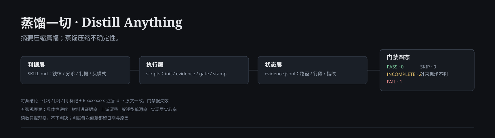

<div align="center">

# 蒸馏一切 · Distill Anything

**把任何对象压成「可证伪的判据 + 可追溯的证据 + 诚实的未知」，而不是又一篇摘要。**
Turn any object — a person, a codebase, a methodology, an incident — into evidence-anchored, falsifiable, reusable knowledge.

[](LICENSE)
[](https://agentskills.io)
[](#快速开始)
[](#五张观察表为什么它不只查格式)
[](#验收)

**[效果示例](#效果示例) · [它是什么](#它是什么) · [快速开始](#快速开始) · [门禁四态](#门禁四态) · [五张观察表](#五张观察表为什么它不只查格式) · [FAQ](#faq) · [English](#english)**



</div>

> 一句话区别：**摘要让你少读几页，蒸馏让你知道哪句话能信、哪句话什么时候会失效。**

---

## 效果示例

真实产物片段（脱敏，完整版在 [`examples/`](examples/README.md)）：

```markdown
- 转写链路的关键参数一条没写：用什么模型、多大、延迟多少、支不支持中文。
  没有这些，写出来的「机制」只能是复述那四条 bullet。[O] raw/readme.md:9
- 它明确「不接受 PR，只收 issue」，所以没有可引的贡献者讨论与设计决策。[O] raw/readme.md:41

## 未知台账
| 未知 | 为什么解不了 | 需要什么才能解 |
|---|---|---|
| 转写模型的选型与体积 | README 未写 | 读 docs 目录或安装包内的模型清单 |
| 粘贴在哪些应用里会失败 | 未实测 | 本机装一次，覆盖终端、浏览器、IDE 各试一次 |
```

同一份产物在门禁下的读数：

```
[PASS] out/distill-hex/report.md
总分 38.3/50   D1 8.6  D2 7.0  D3 6.0  D4 10.0  D5 6.7
```

它没有把材料不足写成「已掌握」，而是**判成 refuse + 留三条未知**——这也是它能被引用、而不是只能被读的原因。

---

## 它是什么

**蒸馏不是摘要（distillation ≠ summarization）。**

| | 摘要 | 蒸馏（本项目） |
|---|---|---|
| 压缩的是 | 篇幅 | 不确定性 |
| 每条结论要回答 | 说了什么 | 凭什么成立、什么情况下不成立、还有什么不知道 |
| 失败形态 | 漏了重点 | 结论没有锚点、锚点指向已失效的原文、把推断写成观察 |
| 能否被机器检查 | 很难 | 能：锚点解析、指纹比对、门禁四态、五张观察表 |
| 交付后 | 读完就完 | 原文一改，门禁立刻报出来 |

它做三件事：

1. **判据层**（`SKILL.md`）：什么算「蒸出来了」、八类对象的探针、流水线、行为禁令。
2. **执行层**（`scripts/`）：建骨架、存证据算指纹、批量校验、锚点收口、写入基线、盲化评分，全交给脚本。
3. **状态层**（`evidence.jsonl` + `notes/`）：每条证据带原文指纹与行段，正文只引 `E-xxxxxxxx`，文件一改门禁就知道。

核心判断标准：**删掉对象的名字，产物还得立得住。**

---

## 五张观察表：为什么它不只查格式

门禁只判结构，所以另配五张**只看数、不下判决**的观察表，用来发现「结构合格但内容空心」：

| 观察表 | 读数含义 | 为什么需要 |
|---|---|---|
| 具体性密度 | 结论行里含具体事实的比例 | 防通篇形容词 |
| raw 材料进证据率 | 采到的材料有多少真的被引用 | 防「抓了没读」 |
| 上游漂移 | 引用的原文与当前上游是否一致 | 防证据过期 |
| 叙述型单源率 | 结论是否全建立在对象自述上 | 防「只复述 README」 |
| 实现层实心率 | 实现层事实里有多少能在原文命中具体符号 | 防「写了设计原则就收工」 |

自用实测（2026-11-14，本机 30 份产物）：

- 门禁 **33/33 PASS**（30 个容器 + 3 份子报告）
- 总分区间 **38.3–48.2**，均值 **44.9**（满分 50，只并 D1–D5）
- 兜底缺口 **D3=0 归零**；实现层实心率入表 3 份、均 100%
- 回归：`run_gate_tests.py` **44/44**、`run_audit_tests.py` **39/39**、`score_product.py --selftest` **17/17**

这些是单人单机的样本，不是行业基准；数字的意义是「同一口径下可重复」，不是「比谁强」。

---

## 快速开始

```bash
# 方式一：装进任意兼容 Agent Skills 的 runtime（Claude Code / Codex / Cursor / Gemini CLI / OpenCode ...）
npx skills add qiuqianyi66/distill-anything

# 方式二：手动放进 skills 目录
git clone https://github.com/qiuqianyi66/distill-anything ~/.claude/skills/distill-anything
```

装好后对 agent 说「蒸馏这个仓库」「把这个方法论做成 skill」，或直接跑 CLI：

```bash
# 1. 建骨架（mechanism / perspective / rules / refuse 四型）
python scripts/distill.py init my-object --type mechanism

# 2. 读到关键段落就存一条证据：读原文、算指纹、追加一行
python scripts/distill.py evidence add \
  --dir out/distill-my-object --path raw/repo/SKILL.md \
  --lines 44-58 --level O --statement "入口只有这一处"

# 3. 正文用 E-xxxxxxxx 引用；交付前过门禁
python scripts/gate.py out/distill-my-object/report.md
python scripts/distill.py gate out --recursive
python scripts/distill.py scan --root out

# 4. 建写入基线：之后被别的程序改写会被抓出来
python scripts/distill.py stamp out/distill-my-object/report.md

# 5. 交付前体检（五张观察表；--remote 才查上游漂移）
python scripts/audit_evidence.py out --remote
```

产物永远写到当前项目的 `out/distill-<slug>/`，不写进技能目录。

---

## 门禁四态

| 状态 | 含义 | 退出码 |
|---|---|---|
| `PASS` | 结构与证据达标 | 0 |
| `INCOMPLETE` | 证据段缺失、锚点未提供、stamp 之后被改写 | 2 |
| `FAIL` | 有结论无锚点、证据指向已失效、引用死链 | 1 |
| `SKIP` | 外来文件或中间件，判据不适用 | 0 |

`SKIP` 是刻意设计：被蒸馏的原始现场（第三方技能、事故现场、`notes/`、`raw/`）本就不声称结论，判它缺证据段是判据过度。识别走两条路径——frontmatter 带第三方技能键且缺 `source`，或目录里有 `.foreign` 标记。

---

## 判据：什么叫「蒸出来了」

1. **去名测试**：删掉名字，产物还能被认出。
2. **生成测试**：拿没谈过的新问题，能给出立场并说明理由。
3. **矛盾测试**：至少留一对未被调和的矛盾。
4. **反模式测试**：至少一条「它绝对不做什么」。
5. **未知测试**：未知台账 ≥3 条，每条写明需要什么才能解。
6. **模型数测试**（仅思维型）：心智模型落在 3–7 个。
7. **张力测试**（仅思维型）：内在张力写成具体场景的两种相反选择。
8. **降级测试**：写明失败时退到哪（触发 → 一线修复 → 仍失败兜底）。

适用八类对象：代码仓库、人物、长文档、技能库、事故、对话日志、竞品、方法论流派。每类的首探针、必查项、已知坑见 [`references/target-matrix.md`](references/target-matrix.md)。

---

## 它站在谁的肩膀上

不装作从零发明。判据里有四条主线是蒸馏别人的产物后改的，`SKILL.md` 的 `source` 字段逐条留了出处：

| 来源 | 借了什么 |
|---|---|
| [alchaincyf/nuwa-skill](https://github.com/alchaincyf/nuwa-skill) | 三重验证、去名测试、增量筛、先验快照、封存件（holdout）验证 |
| [titanwings/distilly](https://github.com/titanwings/distilly) | 工厂式写入、质检不允许伪造 |
| [morluto/rea](https://github.com/morluto/rea) | 证据三元、未知台账、覆盖 ≠ 存在 |
| [cloudflare/security-audit-skill](https://github.com/cloudflare/security-audit-skill) | 双模式授权、不确定无等级 |

与它们的差别：女娲产「人格视角」，distilly 产「写作流水线」，rea 强调证据三元；本项目把重点放在**可机检的判据 + 可复算的读数**上——同一份产物换台机器跑，门禁结论应当一致。

---

## 仓库结构

```
distill-anything/
├── SKILL.md                 # 判据层：铁律 / 分诊 / 流水线 / 判据 / 反模式
├── README.md                # 本文件
├── llms.txt                 # 给 AI 检索器的结构化摘要
├── references/
│   ├── target-matrix.md     # 八类对象：首探针、必查项、已知坑
│   ├── evidence-protocol.md # 三层标记、锚点格式、外部来源分级、纠正流程
│   ├── quality-gate.md      # 门禁阈值 + 每次判据偏差的留痕
│   ├── templates/           # mechanism / perspective / rules / refuse 四型骨架
│   └── ...                  # 评分卡、六维口径等
├── scripts/
│   ├── distill.py           # CLI：init / gate / index / evidence / scan / stamp
│   ├── gate.py              # 单文件门禁，可独立调用
│   ├── audit_evidence.py    # 五张观察表
│   ├── score_product.py     # D1–D5 打分（/50；D6 派生、D7 人工不并入）
│   ├── anchorize.py         # 路径锚点批量换成证据 id
│   ├── d7_blind.py          # 盲化评分，防自由打分
│   └── migrate_legacy.py    # 老产物迁进证据库
├── tests/
│   ├── run_gate_tests.py    # CLI 级回归 44 例
│   ├── run_audit_tests.py   # 观察表回归 39 项
│   ├── test_groups.py       # 五个分组函数的函数级单测
│   └── fixtures/            # 每个判据都配一个能打红的反例
└── examples/                # 两份脱敏成品（rules + mechanism）
```

---

## 验收

```bash
python tests/run_gate_tests.py    # 44/44
python tests/test_groups.py       # 5 组 / 全项通过
python tests/run_audit_tests.py   # 39/39（叙述型单源率 + 实现层实心率）
python scripts/score_product.py --selftest   # 17/17
```

三个测试层互不替代：CLI 级验整份产物的最终状态，函数级直调五个 `_check_*` 分组函数，审计回归验观察表的读数口径。**新增判据时同提交必须给一个能打红的反例**——只有正向断言的测试在判据退化时仍然是绿的。

---

## FAQ

**Q：它和 RAG / 知识库有什么区别？**
A：RAG 解决「取回相关片段」，本项目解决「这条结论能不能被引用」。产物里每条结论必须挂 `[O]/[D]/[I]` 与 `E-` 锚点，锚点带原文指纹；原文一变，门禁报失效。

**Q：和普通摘要 / 读书笔记最大的差别？**
A：摘要可以没有未知；蒸馏不行。未知台账是必填项，少于 3 条直接判不合格。

**Q：会不会编造证据？**
A：门禁能抓「锚点不存在、id 不在库、指纹对不上、行段越界」，抓不了「引用真实但对结论支持不足」。后者只能人工复核，写在诚实边界里，不假装解决。

**Q：支持哪些 agent？**
A：任何兼容 [Agent Skills](https://agentskills.io) 的 runtime 都能装（Claude Code、Codex、Cursor、Gemini CLI、OpenCode 等）；CLI 部分只依赖 Python 3.9+，不联网也能跑（`--remote` 才查上游）。

**Q：处理人物对象时和女娲.skill 什么关系？**
A：女娲专做「人格视角」的运行时 skill；本项目产出的是可核验的分析报告，人物只是八类对象之一。两者可组合：用女娲造视角，用本项目核事实。

**Q：为什么分数上限是 50 不是 100？**
A：只并机器可判的 D1–D5。D6 是三元件派生视图、D7 是人工 0–2 分，二者不并入总分——合成会把「机器分」和「人判分」混成一个看似精确的数。

**Q：门禁 PASS 就等于产物好吗？**
A：不等于。门禁只判结构自洽；内容好不好仍要看五张观察表和人工复核。所有「读数 ≠ 判决」的边界都写在 [`references/quality-gate.md`](references/quality-gate.md)。

---

## 诚实边界

- 判据来自真实踩坑，不是行业标准；`references/quality-gate.md` 每次偏差都留了日期和原因。
- 跨版本不保证：门禁对历史产物有一批 `ok:None` 的豁免（无证据库、无写入基线、锚点未 E 化），这是「不惩罚历史」，不是「已通过」。
- 证据 id 作用域＝容器：跨容器 id 可能相同但只在本容器解析；全局聚合时才需引入 slug。
- 只判结构，判不了「锚点是否指向真实成立的内容」；PDF/图片/表格类产物需人工核对。
- 样本是单人自用 30 份产物，不是多团队压测；数字可复算，但不足以当基准。

---

## 贡献

- 判据与脚本走「先红后绿」：先写一个能打红的反例夹具，再改实现，回归全绿才算过。
- 发现判据偏差请开 issue，附上「哪份产物、哪条结论、机器判成什么、人工判成什么」。
- 不接受把本地路径、真实姓名、凭据、未脱敏产物提交进仓库。

---

## English

**Distill Anything** is an [Agent Skill](https://agentskills.io) + CLI that turns any object — a codebase, a public figure, a long document, a skill library, an incident, a methodology — into an **evidence-anchored, falsifiable** knowledge product instead of another summary.

Every claim carries a provenance marker (`[O]` observed / `[D]` derived / `[I]` inferred) and an `E-xxxxxxxx` evidence id pointing to a file, line range and quote fingerprint. A four-state gate (`PASS / INCOMPLETE / FAIL / SKIP`) checks structure and anchor integrity; five observation tables surface hollow-but-well-formed output (specificity density, raw-material citation rate, upstream drift, narrative single-source ratio, implementation-fact solidity). A 0–50 score covers only machine-checkable dimensions, and D6/D7 are reported separately rather than folded in.

- **Install**: `npx skills add qiuqianyi66/distill-anything` (any Agent Skills-compatible runtime)
- **Run**: `python scripts/distill.py init my-object --type mechanism`, then `evidence add`, `gate`, `stamp`
- **Verified**: gate 33/33 PASS, 30 self-use products scored 38.3–48.2 (mean 44.9), regressions 44/44 + 39/39 + 17/17 (2026-11-14)
- **Not claimed**: this is not a benchmark, not a standard, and the gate cannot tell whether an anchor truly supports a claim — that part stays human.

---

<div align="center">

**摘要压缩篇幅，蒸馏压缩不确定性。**

MIT License · 判据与偏差记录见 [`references/quality-gate.md`](references/quality-gate.md)

</div>
